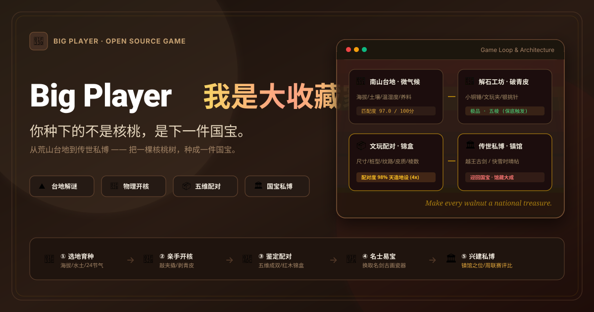

<p align="center">
  
</p>

<p align="center">
  <a href="https://big-player.pages.dev" target="_blank">
    
  </a>
</p>

<p align="center">
  <sub>🌐 在线演示网址：<a href="https://big-player.pages.dev">https://big-player.pages.dev</a> · 浏览器离线秒开即玩 · 支持手机触控与桌面全屏</sub>
</p>

---

<div align="center">

# 我是大收藏家 · Big Player

### **你种下的不是核桃，是下一件国宝。**

<p>
  你继承了一片荒芜的南山核桃园。<br/>
  通过调控地形、水土、光照、温湿度与微量元素，种出品质各异的文玩核桃；<br/>
  亲手敲开青皮，赌出稀有异形与多棱变异；<br/>
  再与性格各异的名士周旋，换回古画、名剑、官窑瓷器，最终建成属于自己的传世私人博物馆。
</p>

[](https://big-player.pages.dev)
[](https://github.com/binterore/big-player/releases)
[](https://github.com/binterore/big-player)
[-blue.svg?style=flat-square)](https://github.com/binterore/big-player)
[](https://react.dev)
[](https://www.typescriptlang.org)
[](https://tailwindcss.com)
[](./LICENSE)

<p>
  <b><a href="#-为什么这款游戏不一样">核心体验</a></b> •
  <b><a href="#-三步核心闭环">玩法闭环</a></b> •
  <b><a href="#-四大特色系统">四大特色</a></b> •
  <b><a href="#-五维配对系统">五维配对</a></b> •
  <b><a href="#-传世典藏与名士录">名士图鉴</a></b> •
  <b><a href="#-数值模型与数学证明">数值证明</a></b> •
  <b><a href="#-快速开始与本地游玩">快速开始</a></b>
</p>

<sub>简体中文 | <a href="#english-summary">English</a></sub>

</div>

---

## 💡 为什么这款游戏不一样？

市面上传统的收集养成游戏，珍品通常靠**无脑抽卡**或**刷怪掉落**。

《我是大收藏家》彻底颠覆了这一范式 —— **你收藏到的每一件传世国宝，都是由你亲手调控土地、亲手开核砸开、精心配对的一颗文玩核桃换来的。**

> [!IMPORTANT]
> **「种什么」决定了「能收藏什么」**。藏品的源头是你自己设计的一方土地、一次精准的环境调控、一次心跳加速的手感开核。这种「因果清晰、努力有回报」的成就感，是任何抽卡游戏都无法比拟的。

---

## 🔄 三步核心闭环

```
  ┌────────────────────────────────────────────────────────┐
  │                        ① 种                            │
  │   在自选台地（海拔/土壤/温湿度/光照）调节微气候与养料   │
  │                  结出特定品质上限的核桃树              │
  └──────────────────────────┬─────────────────────────────┘
                             │
                             ▼
  ┌────────────────────────────────────────────────────────┐
  │                        ② 开                            │
  │    亲手砸开核桃（物理手感交互：小铜锤/文玩夹/银挑针）   │
  │             看青皮裂开，揭晓几棱、纹路与尺寸           │
  └──────────────────────────┬─────────────────────────────┘
                             │
                             ▼
  ┌────────────────────────────────────────────────────────┐
  │                        ③ 藏                            │
  │    送入鉴定所考取证书，凑齐配对放入锦盒，身价暴涨      │
  │    与名士周旋换回古画、名剑、瓷器，登台春秋拍卖会      │
  └──────────────────────────┬─────────────────────────────┘
                             │
                             └──────────── 循环闭合 ───────┘
```

| 环节 | 玩家操作 | 得到什么 | 解锁追求 |
| :--- | :--- | :--- | :--- |
| **① 选台地** | 开垦海拔与土壤各异的种植区 | 一块具备独立微气候的环境 | 扩大适生核桃品种范围 |
| **② 种植调控** | 播种、浇水控湿、调温遮阳、追施微量元素 | 生长中的核桃树 | 冲击多棱异形变异路线 |
| **③ 采收开核** | 选工具破壳（铜锤/文玩夹/挑针） | 棱数、桩型、纹路、皮色明确的文玩核桃 | 鉴定证书、配对素材 |
| **④ 鉴定配对** | 尺寸/桩型/纹路/皮质/棱数五维比对 | 完美配对锦盒（价值提升 2.5 ~ 4 倍） | 收藏家最高阶兑换门槛 |
| **⑤ 交易易宝** | 行商收购、春秋拍卖会出价、名士以物易物 | 巨额铜钱、越王古剑、汝窑天青樽、书画 | 充实私人博物馆、解锁新种子 |
| **⑥ 展馆成型** | 三大展厅格子布展、设置镇馆之宝、抚拭除尘 | 被动馆藏声望与游客收益 | 协会周联赛冲榜、升降级 |

---

## 🌟 四大特色系统

### 1. ⛰️ 台地微气候系统 —— 用「土地」组合出核桃
不是单调的数值升级，而是**三层条件**共同决定产出上限：
- **Ⅰ 结构条件（固定基底）**：海拔（低地 / 丘陵 / 高山 / 雪线）、土壤类型（沙土 / 壤土 / 黏土 / 岩土）。
- **Ⅱ 环境条件（日常调控，受 24 节气修正）**：湿度、温度、光照、水源（雨水 / 溪水 / 山泉 / 雪水）。
- **Ⅲ 消耗条件（一次性冲刺）**：有机肥、磷肥、钾肥、硼元素（专冲多棱异形）。

> **解谜范例**：想种出罕见的「五棱」甚至「六棱」核桃，玩家必须把一块**雪线高海拔、岩土**台地，在生长期维持**干燥、冷凉、强日照、山泉引水**，并在结核期追加**含硼微量元素**。条件严丝合缝对上，方能激发变异！

---

### 2. 🔨 开核工坊 —— 把「赌」做成一门手感
开核是文玩体验的情绪最高点。未开前，只有青皮估测尺寸与行家预判；裂开瞬间，全属性揭晓！
- **操作手法选择**：
  - **小铜锤**：力道稳健，出核规整，保形度 ~94%；
  - **文玩夹**：受力均匀，剥皮迅速，保形度 ~86%；
  - **银挑针**：轻巧细致，专护异形棱尖，保形度 ~96%。
- **视听触觉模拟**：青皮裂纹蔓延动效、Web Audio 纯合成木壳爆裂脆响、移动设备真机触觉震动反馈。

---

### 3. 📦 配对系统 —— 收藏的真正深度
文玩核桃最讲究的不是单只多大，而是**「能不能配成一对」**。

$$\text{配对度} = 0.25 \times \text{尺寸得分} + 0.20 \times \text{桩型得分} + 0.25 \times \text{纹路得分} + 0.15 \times \text{皮色得分} + 0.15 \times \text{棱数得分}$$

> [!CAUTION]
> **棱数硬性门槛**：异棱核桃棱数必须严格相同（例如四棱只能与四棱配对）。棱数不匹配时，棱数单项直接判定为 **0 分**，无法达成成双配对！

- **天造地设（$\ge 95\%$）**：两核尺寸分毫不差，同桩同纹同骨色，封入锦盒整体身价翻 **4 倍**！
- **成双成对（$\ge 85\%$）**：骨架协调、步调一致，身价翻 **2.5 倍**，满足高端名士兑换要求。

---

### 4. 🏛️ 私人典藏博物馆与春秋拍卖会
- **三大展厅陈列**：文玩核桃厅、翰墨书画厅、金石瓷器厅，支持自由格子布展。
- **中央镇馆之宝**：每厅设立唯一的“镇馆之台”，金光璀璨，按展品品级为全馆提供高额声望与被动门票收益。
- **藏品抚拭与包浆**：收来的国宝古物带有岁月破损与陈旧痕迹，使用羊毫与养护油除尘打蜡恢复精品；核桃支持随手摩挲盘玩，积累盘玩火候产生玉化包浆！
- **春秋实时拍卖大会**：
  - 玩家将珍品送拍，设定托底保留价（未达托底价流拍返还）；
  - 多位各具性格的 NPC 实时举牌竞价（老砚台稳重、铸剑翁激进、西洋客压哨绝杀）；
  - 玩家亦可在买家席举牌加价，体验捡漏博弈的窒息快感！

---

## 📜 传世典藏与名士录

游戏中出现五位性格鲜明、偏好各异的收藏名士。投其所好，换取传世国宝：

| 收藏家 | 名士偏好与执念 | 他要什么核桃 | 换回什么国宝 |
| :--- | :--- | :--- | :--- |
| **老砚台** | 金石碑帖，最重文人气韵 | 四棱及以上、纹路规整端庄 | 《快雪时晴帖》摹本、《展子虔游春图》、《米芾蜀素帖》 |
| **铸剑翁** | 踏遍天下，寻访神剑 | 雪线高山孕育的五棱、六棱奇核 | 越王勾践青铜古剑、龙泉七星剑、汉代环首刀 |
| **瓷痴** | 出身窑口世家，眼底容不得瑕疵 | 成功配对（配对度 $\ge 85\%$）锦盒 | 北宋汝窑天青弦纹樽、成化斗彩鸡缸杯、元青花梅瓶 |
| **西洋客** | 远航巨贾，偏爱宏伟奇珍 | 边宽 $\ge 46\text{mm}$ 超大果或造化异品 | 日内瓦黄金机械怀表、老坑玻璃种帝王绿满翠佩 |
| **园主旧友** | 祖父故交，愿看核桃园重现生机 | 普核两棱亦收（门槛亲民） | 大明宣德紫铜桥耳炉、奇楠沉香山子、改良良种与肥料 |

---

## 🧮 数值模型与数学证明

本项目严格遵循并实现了策划文档 **第 15.3 节** 的核心数值模型：

```typescript
// 单项得分规则：理想区间=100分，偏离1档=70分，偏离2档=40分，偏离3档以上=0分
台地匹配度 = 海拔得分×0.20 + 土壤得分×0.15 + 湿度得分×0.15 
           + 温度得分×0.15 + 光照得分×0.15 + 水源得分×0.10 + 养料得分×0.10

品质系数 = 台地匹配度 × 0.8
```

### 策划标准算例验算结果（已纳入自动化单元测试）
- **测试品种**：岩生异棱（偏好：雪线/高山、岩土、干燥、冷凉、强日照、山泉、施加硼元素）
- **计算过程**：
  $$\text{匹配度} = 100 \times 0.20 + 100 \times 0.15 + 100 \times 0.15 + 100 \times 0.15 + 100 \times 0.15 + 100 \times 0.10 + 70 \times 0.10 = 97.0$$
  $$\text{品质系数} = 97.0 \times 0.8 = 77.6$$
- **保底判定**：品质系数 $77.6 \ge 70$，**精准触发保底至少产出 1 个五棱极品**！

---

## 🚀 快速开始与本地游玩

### 1. 克隆代码仓库
```bash
git clone https://github.com/binterore/big-player.git
cd big-player
```

### 2. 安装依赖并启动
```bash
# 安装依赖
pnpm install

# 启动本地开发服务器
pnpm dev
```
打开浏览器访问 **`http://localhost:3000`**，即可开始你的大收藏家之旅！

### 3. 运行算法验算测试
```bash
pnpm test
```
终端将运行 Vitest 自动化测试套件，验证台地微气候算法、保底规则与五维配对严谨性。

---

## 🏛️ 项目工程结构

```
big-player/
├── assets/                    # 项目视觉资产与 Banner
│   └── banner.svg             # 高清国风矢量宣传主图
├── src/
│   ├── types/                 # 全局数据模型 (Terrace, Walnut, Antique, Collector...)
│   ├── config/                # 策划配置表 (Varieties, Antiques, SolarTerms, Collectors...)
│   ├── services/              # 纯函数计算与算法引擎
│   │   ├── climateEngine.ts   # 适生匹配度与品质系数计算器
│   │   ├── walnutGenerator.ts # 开核手感模拟与品相生成
│   │   ├── pairingEngine.ts   # 五维配对算法与锦盒加成
│   │   ├── marketEngine.ts    # 动态 NPC 交易市集
│   │   └── auctionEngine.ts   # 实时竞价拍卖行引擎
│   ├── context/               # 游戏全局状态与 LocalStorage 实时自动存档
│   ├── components/            # 沉浸国风 UI 模块
│   │   ├── garden/            # 台地微气候调控与播种采摘
│   │   ├── workshop/          # 物理开核工坊与解石破壳
│   │   ├── appraisal/         # 品相鉴定所与文玩配对阁
│   │   ├── museum/            # 私人博物馆三大展厅布展与保养
│   │   ├── market/            # 聚宝市集与春秋实时拍卖大会
│   │   ├── collectors/        # 名士雅集以核易宝与飞鸽传书
│   │   └── society/           # 鲁班技艺阁与协会周评比联赛
│   └── utils/
│       └── audio.ts           # Web Audio 纯合成脆裂声与触觉震动
└── README.md
```

---

<a name="english-summary"></a>
## 🌐 English Summary

**Big Player** is an oriental simulation management & antique collecting game built with React 18, TypeScript, and Tailwind CSS.
- **Core Loop**: Cultivate terraces (adjust altitude, soil, microclimate, and fertilizers) $\rightarrow$ Crack raw walnuts with physical tools (hammers, clamps, picks) $\rightarrow$ Pair twins with a 5D algorithm $\rightarrow$ Trade with collectors to exchange for national treasures (swords, calligraphy, porcelain) $\rightarrow$ Build your private museum and compete in weekly association leagues.
- **Zero Backend Required**: Runs 100% client-side with intelligent NPC market ecosystems, real-time auction bidding simulation, and local persistence.

---

## 📄 License

Distributed under the **MIT License**. See `LICENSE` for more information.
